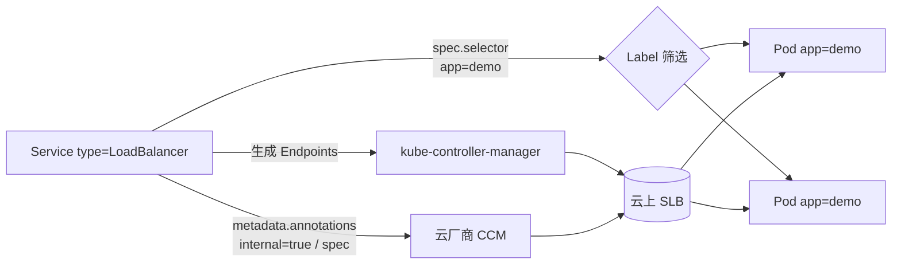

# K8s Label vs Annotation 消化范例（2026-09-13，豆包对话附件，两轮）

## 素材

用户发来「和豆包的对话_0913.txt」，内容：K8s Label 与 Annotation 的区别（豆包讲了两轮，含命名规则、LB 绑定链路、Helm 关联）。

- **第一轮**用户自述理解：「label 是用来筛选的，service 到 pod 要 select，亲和性也依靠 label；annotation 是用来应用配置或者更新状态的，比如 helm 参数、lb 参数」
- **第二轮**（群内复述）：「label 因为需要去筛选；annotation 是便利贴，更新频繁、格式自由、筛选需求不大」——便利贴比喻在纠偏后仍滑回，被本范例标记为陷阱

## 用户偏差清单（纠偏要点，两轮合并）

1. **Label 本质不是「筛选」而是「身份标识」**——筛选只是消费方式；判断标准：要不要参与「选中一批资源」？要 → Label。
2. **真正的分界线不是「程序读 vs 人读」**——annotation 大量被程序读（ingress-nginx、CCM、cert-manager）。分界线是：**K8s 原生能不能拿它做 selector 筛选**。能 → Label；不能 → Annotation。
3. **Helm 两样都用**——label（managed-by，用于 kubectl -l 筛选）+ annotation（meta.helm.sh/release-name、hooks，用于归属跟踪，不参与筛选）。
4. **「便利贴」比喻是坑**（第二轮）：Annotation 主力读者是外部程序/工具，不是人；便利贴带偏成「给人看备注」，换「快递单备注」更准。
5. **更新频率是设计副产品，因果别反**：Annotation 频繁更新无连锁反应 = 因不参与 selector；Label 改动会引发关联重算（改 Pod label → Endpoints 集/认领/NetworkPolicy 变化；改 Node label → 调度重算）。
6. **Label 严格限制换的是能力**：≤63 字符 + DNS 命名（kubernetes.io/ k8s.io/ 保留前缀）换来「可索引 + 可关联」；Annotation 放弃被选择换来格式自由（JSON/长文本，总量 ~256KB）。
7. **筛选的另一面是关联（binding）**：同一 selector 既查询也认领（Deployment 认领 Pod、Service 聚合后端、PDB 圈驱逐范围）——别只当「查询用」。

## 一句话记忆（修正版）

> Label = 身份证（K8s 拿它挑人/认领）；Annotation = 快递单备注（程序读配置/存状态，不参与认领）。分界线是「能不能参与 K8s selector 筛选」，不是「谁在看」。

## mermaid 图（LB 场景两条链路）

- 选后端 Pod：只有 Label（spec.selector）→ Endpoints → 注册进 SLB 后端组
- 配 SLB 实例本身：只有 Annotation（内网/规格/证书/健康检查）→ 云 CCM 只认这个

## 开放问题收尾（反馈闭环，第二轮版本）

1. 判定：只让带 `tier=db` 的 Pod 收到 Service 流量 → Label；记「哪个团队建的」 → Annotation。
2. 深问题：为什么 K8s 不让 Annotation 也能被 selector 筛选？（提示：约束换能力——允许任意格式进 selector，索引/确定性崩坏）

## 落库衔接（2026-09-13 实操）

用户未答验证题直接要求落 wiki：新建 `concepts/cloud-native/k8s-label-vs-annotation.md`，把验证题写入页内 `## 自测` 段落（含答案提示），index+log 更新，commit 不 push（zach-llm-wiki 流程）。模式：用户跳过验证时，落库 + 内置自测题保留闭环，而非卡住等待。

## 复用提示

同样的消化结构可直接套到其他概念对：selector/affinity、ConfigMap/Secret、StatefulSet/Deployment、Pod/Container 等 K8s 概念差异教学。